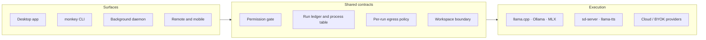

<div align="center">


# Little Monkey

**Local AI coding agents with inspectable permissions, durable work and reviewable changes.**

Give an agent a real repository task, control what tools it can use, and inspect the tests and diff before accepting a result. Use a model on your machine or a provider you configure.

[](https://github.com/AA-Box/little-monkey/actions/workflows/ci.yml)
[](https://github.com/AA-Box/little-monkey/releases/latest)
[](LICENSE)
[](docs/setup.md)

### [Download the latest stable release](https://github.com/AA-Box/little-monkey/releases/latest) · [Try a real coding task](docs/first-run.md) · [Check limitations](docs/limitations.md)

[Quick start](#quick-start) · [Features](docs/features.md) · [Security](docs/security.md) · [Contribute](CONTRIBUTING.md) · [Roadmap](ROADMAP.md)

</div>

> **Release vs. development:** You are reading the `develop` branch. Its feature and limitation docs describe the **development tree**, which can contain changes not included in the latest published installer. Before relying on a capability in an installed version, check the [latest release notes](https://github.com/AA-Box/little-monkey/releases/latest) and select that release's tag in GitHub to read its matching documentation. `main` is the release branch; `develop` is not a release promise.

## Watch the workflow, then try it

**A small, verifiable coding task:** The [first-run example](examples/first-run/) contains a real bug and a failing Node.js test. You can reproduce the failure yourself, ask Little Monkey to fix it, and independently rerun the same test. No simulated terminal output or claimed success rate is involved.

```text
Open a workspace with a failing test
              ↓
Give an agent the task and choose its model
              ↓
Review requested file / command permissions
              ↓
Inspect the edits, test evidence and Git diff
              ↓
Independently rerun the test before accepting changes
```

**[Follow the reproducible first-run walkthrough →](docs/first-run.md)**

There is not yet a checked-in recording of a real desktop run. The [recording protocol](docs/adoption.md#publish-a-real-demo-not-a-mockup) explains what must be captured before a video or screenshot can honestly be shown here.

## Why use Little Monkey for repository work?

| What you need | How Little Monkey approaches it |
| :-- | :-- |
| **Local or BYOK models** | Use the managed `llama.cpp` runtime, Ollama, MLX on supported Apple Silicon, or a configured provider. Model quality and tool support depend on the actual model. |
| **Inspectable execution** | File edits, commands and tool calls are subject to explicit permissions and workspace boundaries; see [Security](docs/security.md). |
| **Work that survives closing a window** | Daemon-backed tasks can preserve state and resume under the documented recovery rules. An ordinary desktop chat turn is **not** a crash-resumable live agent loop; see [Limitations](docs/limitations.md). |
| **Review rather than blind trust** | See file changes, tool activity and verification evidence. Tests should be independently rerun before relying on a result. |

Little Monkey is also an extensible local agent platform with voice, Studio, knowledge, workflows, swarms and IDE clients. Those are documented in the [full feature inventory](docs/features.md); this introduction focuses on the coding workflow instead of treating every feature as the main product.

## How it fits together



Nothing reaches a runtime without passing the middle row. That is the whole design: a tool call, a scheduled recipe and a request from a paired phone are the same kind of thing by the time they arrive.

## Install

Take the installer for your platform from the [**latest release**](https://github.com/AA-Box/little-monkey/releases/latest):

| macOS | Windows | Linux |
| :-- | :-- | :-- |
| `.dmg` — Apple Silicon, Intel | `.exe`, `.msi` — x64, arm64 | `.AppImage`, `.deb`, `.rpm` — x86_64, aarch64 |

Bundles ship a pinned, checksum-verified `llama.cpp` runtime and install the `monkey` command on first launch without elevation. Every release carries per-asset signatures, the signing public key and a CycloneDX SBOM. Optional runtimes are listed in **[Setup](docs/setup.md)**.

Release assets also include the versioned IDE clients: `little-monkey-vscode-1.0.0.vsix` for VS Code and `little-monkey-jetbrains-1.0.0.zip` for JetBrains IDEs. Install them from the release page; marketplace publishing is not automatic.

Building from source instead: [Development](#development).

## Quick start

<details open>
<summary><b>From the terminal</b></summary>

```sh
monkey llama3.2 "Summarize this project"   # chat, model first
monkey pull llama3.2:3b                    # app-owned runtime, no Ollama needed
monkey run hf.co/Qwen/Qwen2.5-Coder-0.5B-Instruct-GGUF:Q4_K_M
```

`monkey run` resolves immutable metadata, verifies the model's SHA-256, reads the checksum-bound GGUF's own chat template before advertising tool support, and starts a loopback-only runtime for that session.

</details>

<details>
<summary><b>From the desktop app</b></summary>

Pick a model straight from the composer's searchable picker — it also adds new local, Ollama, and provider models inline — or in **Settings → Local Models**, **Settings → Ollama**, or **Settings → AI Providers**, then chat. In the composer, `@` references workspace paths, `/` invokes skills, `/btw` asks a side question that never rejoins the conversation, and the send button becomes **Talk** while there is nothing to send.

</details>

<details>
<summary><b>As an API server</b></summary>

```sh
monkey api-serve --port 8080
```

Serves the OpenAI-compatible routes, the Anthropic Messages subset, and native-Ollama `GET /api/tags` and `POST /api/chat` under one authentication, pairing, rate-limit and CORS policy. Loopback is the default; anything else demands an exact interface, TLS identity and allowlist.

</details>

<details>
<summary><b>Beyond coding: more Little Monkey capabilities</b></summary>

### Additional capabilities

| | |
| :-- | :-- |
| **Chat &amp; collaboration** | Compare one frozen prompt across up to four targets, run Crew chats with a coordinator and parallel members, fork sessions, split-pane, search everything, set up models from the searchable picker itself, and paste big blobs as editable Markdown cards |
| **Voice** | Two Talk engines: a private classic pipeline with bundled local Whisper, local wake word and arbitrary local/cloud models, plus native WebRTC Realtime voice. Route microphone and speaker independently between the desktop and paired devices, with barge-in, the same conversation, tools and permission boundary |
| **Workspace** | Code review over real git porcelain, acceptance-criteria mapping whose citations are checked against the diff, a real PTY terminal, a tabbed browser pane |
| **Agent tools** | File, shell, memory, web, knowledge, MCP, subagent, plan and verification tools — every one behind the permission gate, with checkpoints you can rewind |
| **Knowledge 2.0** | Ingest files, sites, chats and WebDAV; hybrid lexical and vector retrieval with reranking; inspect the whole pipeline end to end |
| **Runtime hub** | Offload planning from a live hardware snapshot, versioned runtime components, a Driver Doctor that says what *executes*, MLX chat with safetensors repositories installed straight from a Hugging Face URL, and image reading on models whose own files prove a vision tower |
| **Studio** | Native MFLUX image generation on Apple Silicon, managed `sd-server` image/video, MLX video, gallery export and local speech, from weights on your own disk |
| **Skills &amp; workflows** | Digest-approved skills, signed packages, MCP Apps, and typed workflow DAGs with triggers, replay and human-approval nodes |
| **Standards** | Evidence-backed Standards Studio: deterministic discovery of the repository's own conventions, explicit approval, per-turn selection frozen into the run, executable checker gates, and drift tracking |
| **Extensions** | Sandboxed WASM extensions with a full `monkey extensions` developer loop, a signed static-registry marketplace with fail-closed updates, and one unified Ecosystem catalog |
| **Runs &amp; limits** | Ten tracked process kinds, durable stop/suspend/resume from anywhere, and budgets that record *which* limit fired |

Every one of these has its boundary written down: **[full feature list](docs/features.md)** · **[what each stops short of](docs/limitations.md)**


</details>

## Voice architecture

```text
                         Talk
                          │
             ┌────────────┴────────────┐
             │                         │
      Classic Pipeline             Realtime
             │                         │
    local/cloud STT              WebRTC audio
             ↓                         ↓
       any selected LLM          realtime model
             ↓                         │
       local/cloud TTS                 │
             └────────────┬────────────┘
                          │
                      VoiceRoute
                    ↙             ↘
              local device     paired device
```

Classic Pipeline can stay completely local: local wake word → bundled Whisper → local model → local speech. Realtime uses native streaming audio for lower-latency conversation. Voice Everywhere independently routes the microphone and speaker between this computer and paired devices.

> **Where this stops.** Paired browser companions capture microphone audio only while the page is in the foreground. Remote **Always Listening** and wake-word detection are not available on a paired companion — wake detection has to run on the endpoint holding the microphone, and streaming continuous ambient audio off a device is not something this project does. Paired **Realtime** requires the desktop app to be open, because the WebRTC provider session lives in its webview. Full boundaries: **[Realtime voice](docs/realtime-voice.md)** · **[Voice Everywhere](docs/voice-everywhere.md)** · **[Limitations](docs/limitations.md)**.

## Security

Workspace paths are canonicalized and traversal and symlink escapes refused. Agent shells run kernel-confined — macOS Seatbelt, Linux Landlock + seccomp, Windows AppContainer + job object — writable only inside the selected workspace, with a scrubbed environment. Loopback is the default for every served surface, keys live in the OS keychain, and no remote server, model output, web page, package or archive can approve its own operation.

The audit trail is queryable, and each command exits non-zero on the condition that is the bug:

```sh
monkey security audit               # posture, without contacting a model
monkey security permission-gaps     # a mutating call with no decision behind it
monkey security subsystem-events    # the hash-chained cross-subsystem stream
monkey security egress-evidence     # allowed destinations beside refused ones
monkey security admission-trail     # the run behind each scheduling decision
```

Boundaries in full: **[docs/security.md](docs/security.md)**. Vulnerabilities go through a [private advisory](https://github.com/AA-Box/little-monkey/security/advisories/new), never a public issue — see [SECURITY.md](SECURITY.md).

## Documentation

| To do this | Read |
| :-- | :-- |
| See what the app does today | [Features](docs/features.md) |
| Drive it from a terminal | [CLI](docs/cli.md) |
| Run a bounded autonomous task with durable evidence | [Autonomous tasks](docs/autonomous-tasks.md) |
| Run work on local, Docker, paired-node, or SSH executors | [Execution targets](docs/execution-targets.md) |
| Build, test, or find the code | [Setup and development](docs/setup.md) |
| Understand the trust model | [Workspace and trust boundaries](docs/security.md) |
| Know where a claim stops | [Limitations](docs/limitations.md) |
| Adopt your repository's own conventions | [Standards Studio](docs/standards-studio.md) |
| Install executable extensions from a signed registry | [Extension marketplace](docs/extension-marketplace.md) |
| Build and publish an extension | [Extension development](docs/extension-development.md) |
| Speak to it with local transcription | [Zero-config local Whisper](docs/zero-config-local-whisper.md) |
| Arm a wake word that keeps passive audio on this machine | [Local wake-word detection](docs/local-wake-word.md) |
| Hold a low-latency spoken conversation over WebRTC | [Realtime voice](docs/realtime-voice.md) |
| Route a Talk microphone or speaker to another device | [Voice Everywhere](docs/voice-everywhere.md) |
| Connect remote MCP servers and work accounts over OAuth | [BYO OAuth clients](docs/byo-oauth-clients.md) |
| Use a paired phone's camera, mic or location | [Paired devices](docs/paired-devices.md) |
| Reach an agent by message, phone, device or peer | [Messaging, devices and phones](docs/messaging-devices-and-phones.md) |
| Check the conformance suite | [Conformance suite](docs/conformance-suite.md) |

## Development

Node.js, `pnpm`, Rust, Cargo and your platform's Tauri 2 prerequisites are required.

```sh
pnpm install
pnpm dev:app         # stage llama.cpp + the CLI sidecar, then run the app
pnpm dev             # Vite front end only
pnpm build           # TypeScript check and production front-end build
pnpm tauri build     # desktop bundle containing the managed runtime
pnpm test            # front-end suite
pnpm test:rust       # Rust suite, all targets
```

Extension tests, the opt-in checks that need real models or hardware, and the project layout are in **[Setup and development](docs/setup.md)**. Authors of sandboxed Component Model integrations should start with the **[extension developer loop](docs/extension-development.md)** (`monkey extensions init|dev|test|pack|sign|publish`), then **[Executable extensions](docs/executable-extensions.md)**, the **[marketplace and distribution model](docs/extension-marketplace.md)**, and the **[Rust SDK examples](extensions-sdk/README.md)**.

## Contributing

Bug reports, fixes and feature proposals are welcome. [CONTRIBUTING.md](CONTRIBUTING.md) covers setup, the full check suite, what CI runs per platform, and the invariants a change must hold: honest capability claims, no fabricated runtime values, untrusted content that cannot approve its own operation, and unchanged permission and network boundaries.

Pull requests target `develop`; `main` is the release branch.

<div align="center">
<sub>MIT licensed · built for people who want the agent on their own machine</sub>
</div>
